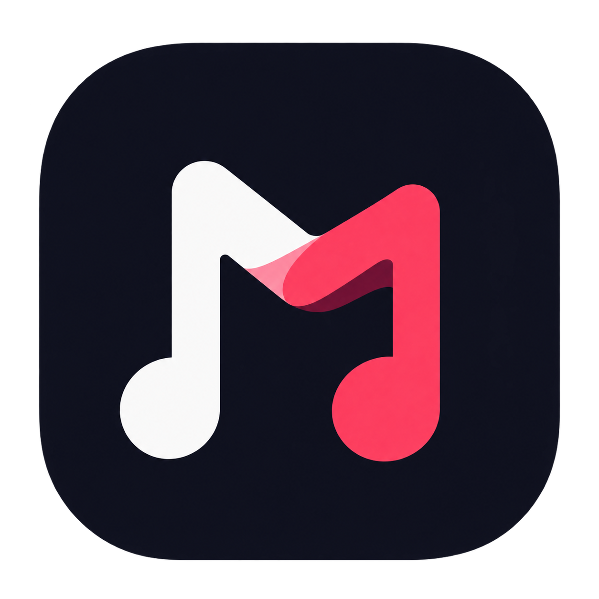

<p align="center">
  
</p>

<h1 align="center">Muse Flow</h1>

<p align="center">
  Everything you love about <a href="https://github.com/iamaffanyasir/muse">Muse</a> — plus online search, live streaming,<br>
  downloadable playlists and song sharing.<br>
  <a href="https://github.com/iamaffanyasir/muse-flow/releases/latest/download/MuseFlow.apk"><b>⬇ Download the latest APK</b></a>
  · <a href="https://iamaffanyasir.github.io/muse/#flow">Website</a>
</p>

---

## Features

- **Search online** — fast YouTube Music search with real titles, artists, albums and square covers.
- **Listen live** — stream any song instantly without downloading; the next song is prepared in the background.
- **Playlists** — build playlists from online songs and your own library; download a single song or the whole playlist.
- **Downloads your way** — choose **MP3** (128–320 kbps), **M4A** or **Opus** once in Settings and every download follows it. Title, artist, album and square cover art are embedded automatically. Files are saved to `Music/Muse Flow`.
- **Paste any link** — YouTube, YouTube Music, SoundCloud, Bandcamp and many more (powered by yt-dlp, the engine behind [Seal](https://github.com/JunkFood02/Seal)). Share links straight into the app.
- **No duplicates** — songs already in your library are recognised and never downloaded twice.
- **Share songs** — send a friend a link; with Muse Flow installed it opens and plays instantly.
- Plus everything from Muse: 8 Now Playing styles, equalizer, theming, AMOLED mode, artwork-coloured animations.

## Install

1. Download [`MuseFlow.apk`](https://github.com/iamaffanyasir/muse-flow/releases/latest/download/MuseFlow.apk) on your Android phone.
2. Open it and allow **Install unknown apps** when asked.
3. On first launch Muse Flow unpacks its downloader — give it ~30 seconds.

Requires **Android 8.0** or newer on a **64-bit (arm64)** phone — nearly every phone from the last several years. yt-dlp keeps itself updated every few days.

## Disclaimer

Muse Flow is a personal project, developed **only for downloading non-copyrighted music** — royalty-free and Creative Commons tracks, your own uploads, or music whose creators permit downloading. The developer does not host, store or distribute any content, and is **not responsible for any unlawful use of this app or any copyright conflicts** arising from it. You are responsible for respecting copyright law and each platform's terms of service. Muse Flow is not affiliated with YouTube, Google or any other platform.

## Build it yourself

```bash
git clone https://github.com/iamaffanyasir/muse-flow.git
cd muse-flow
./gradlew assembleRelease        # Windows: gradlew.bat assembleRelease
```

Built with Kotlin, Jetpack Compose, Media3 (ExoPlayer) and [youtubedl-android](https://github.com/JunkFood02/youtubedl-android) (yt-dlp + ffmpeg).

---

<p align="center">Built with ♥ by <a href="https://visualter.in">Visualter</a> · <a href="https://github.com/iamaffanyasir">Mohammad Affan Yasir</a></p>
